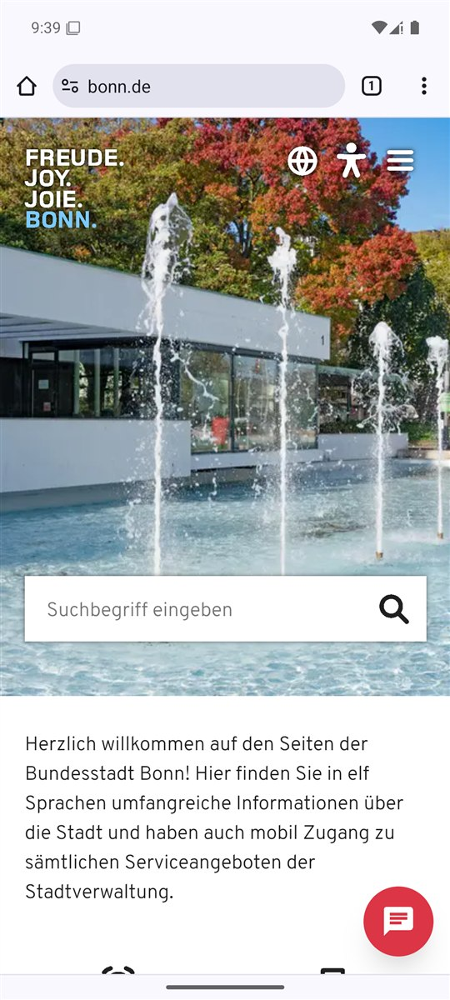
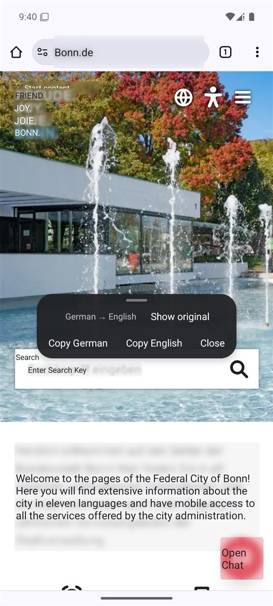
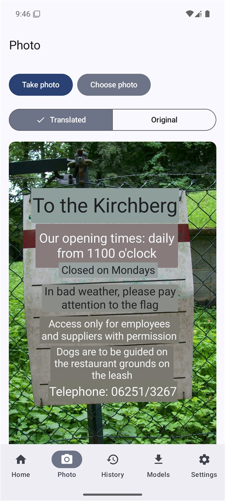
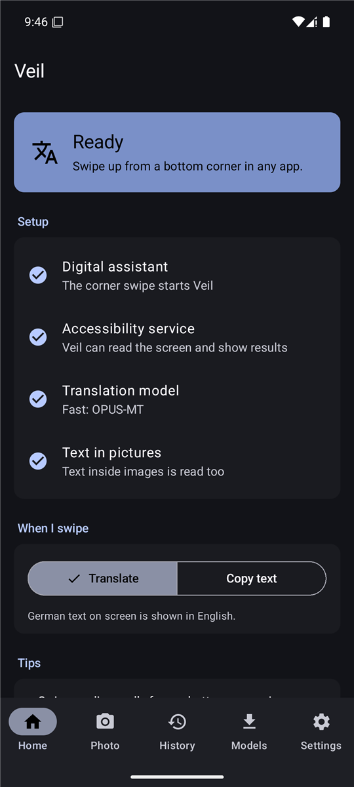
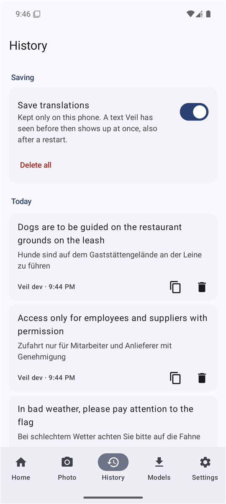
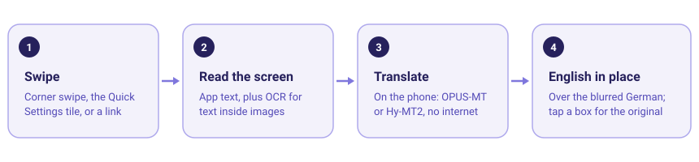

<p align="center">
  
</p>

<h1 align="center">Veil</h1>

<p align="center">
  <b>German on your screen, English in its place.</b><br>
  Swipe from a corner in any app and the German text is replaced, right where it is, by English.<br>
  Translated on your phone: no account, no cloud, no Google services.
</p>

<p align="center">
  <a href="https://github.com/oowais/veil/releases/latest"></a>
  
  <a href="LICENSE"></a>
</p>

---

*Veil* lays a thin veil over the screen: the German underneath goes soft and blurred, the English
sits on top in the same place, in the page's own colours. A letter from the Bürgeramt, a German app,
a menu on a website, a sign in a photo: one swipe, and you can read it. Nothing you translate
leaves the phone.

<table align="center">
  <tr>
    <td align="center" width="270"></td>
    <td align="center" width="270"></td>
    <td align="center" width="270"></td>
  </tr>
  <tr>
    <td align="center"><sub><b>Any German page</b><br>Here bonn.de in Chrome</sub></td>
    <td align="center"><sub><b>One swipe later</b><br>English in place, even text in the photo</sub></td>
    <td align="center"><sub><b>Photo mode</b><br>Signs, letters, menus</sub></td>
  </tr>
</table>

<table align="center">
  <tr>
    <td align="center" width="270"></td>
    <td align="center" width="270"></td>
  </tr>
  <tr>
    <td align="center"><sub><b>Set up in four steps</b><br>Home shows what's left</sub></td>
    <td align="center"><sub><b>History</b><br>Copy or delete, or turn saving off</sub></td>
  </tr>
</table>

<p align="center">
  
</p>

> **Status: early (0.x).** Built and used on a Pixel 9. Other phones should work but are less tested;
> please report what you see.

## Features

- **Translate in place.** English boxes over the original, blurred German behind them, toolbar to
  show the original, copy German or English, or close. Tap a box for its German, long-press to copy.
- **Any app, also text in images.** Reads the text apps expose to Android, and runs text recognition
  (OCR) on a screenshot for text inside pictures, games and apps Android can't see into.
- **Three ways to start it.** The corner swipe (Veil is your digital assistant), a Quick Settings
  tile, or `veil://translate` from Tasker, Key Mapper or adb.
- **Photo mode.** Take a photo with the camera or pick one from the gallery: Veil draws the English
  into the picture. Zoom, rotate, translate only a part, tap a box for its German, then save (as
  taken or translated) or share.
- **Two translation engines.** OPUS-MT: small (110 MB) and fast, the default. Hy-MT2 1.8B: better
  wording, needs about 2.5 GB of memory. Hy-MT2 also follows your own **glossary** ("Sitzung =
  session").
- **History.** Every translation with app and time; copy, delete one or all, or turn saving off.
  Screens you've seen before translate instantly.
- **Copy text mode.** Outlines all text on screen so you can copy any of it, no translation.
- **Your settings.** Where text comes from (app text, images, or both), box text size and how much
  of the original shows through, keep short lines like buttons as separate boxes.
- **Updates in the app.** A daily check (can be turned off) and one-tap updates, signed by the
  maintainer.

## Get it

Requires **Android 11+** on a 64-bit ARM phone (almost every phone from the last years).

1. Download [`veil.apk`](https://github.com/oowais/veil/releases/latest/download/veil.apk) and
   install it (allow "install unknown apps" for your browser or file manager). Later versions
   install from inside the app: Settings → Updates.
2. Open Veil. **Home** shows what's left to set up:
   - make Veil the **digital assistant** (Android's settings open for you),
   - turn on Veil's **accessibility service** (if Android says "Restricted setting": App info →
     ⋮ → Allow restricted settings),
   - download a **translation model** on Models; **text recognition** (31 MB) is optional but
     needed for text in images and for photo mode.
3. In any app, swipe up diagonally from a bottom corner. Swipe again, press Back or tap outside to
   close.

Something wrong? Settings → Troubleshooting → Activity log → Copy, and attach it to an
[issue](https://github.com/oowais/veil/issues).

## How it works

1. **Trigger.** Veil is registered as the default digital assistant, so Android's assistant gesture
   (corner swipe, or long-press power on some phones) starts it, invisibly. The Quick Settings tile
   and `veil://translate` go through the same path.
2. **Read.** The accessibility service collects the text on screen with its position; each text is
   already a whole paragraph. In parallel, a screenshot goes through PP-OCRv6 (ONNX Runtime) for
   text in images; its lines are grouped into paragraphs, hyphenated words joined.
3. **Pick.** A quick check keeps only German text, so English and numbers stay as they are.
4. **Translate.** On the phone, in batches: OPUS-MT (Marian, int8, ONNX Runtime) sentence by
   sentence, or Hy-MT2 1.8B (llama.cpp) with numbered segments, told when text came from OCR and
   given your glossary. Results are cached and saved to History.
5. **Show.** An accessibility overlay draws one box per paragraph: a blurred crop of the original
   under a veil in the page's colour, the English sized to fit.

Design notes, decisions and status: [`docs/`](docs/).

## Privacy

Veil does no analytics and sends no telemetry. Screen text, photos, translations, History and the
activity log stay in the app's private storage on the phone. Veil uses the network for two things
only:

- **Model downloads**, which you start yourself (on mobile data it asks first). Models can also be
  imported from files or side-loaded; see [MODELS.md](MODELS.md).
- **Update check:** once a day, when you open the app, Veil asks GitHub
  (`api.github.com/repos/oowais/veil/releases/latest`) for the latest version. GitHub sees your IP
  address; nothing else is sent. Turn it off in Settings → Updates; "Check now" still works by
  hand. Updates are only downloaded and installed when you tap Update, and Android asks you to
  confirm. They are signed with a key only the maintainer holds.

Veil needs the accessibility service to read and cover the screen. It skips password fields, does
nothing on the lock screen, and only looks at the screen when you trigger it.

## Build from source

Kotlin · Jetpack Compose (app screens) · ONNX Runtime (OCR, OPUS-MT) · llama.cpp through JNI
(Hy-MT2). Needs JDK 21, the Android SDK and NDK `29.0.14206865`.

```bash
git clone --recurse-submodules https://github.com/oowais/veil
./gradlew lint testDebugUnitTest assembleDebug   # → app/build/outputs/apk/debug/app-debug.apk
```

Debug and profile builds are "Veil dev" (`com.owaisahmed.veil.dev`), signed with a public debug key;
they install next to the release app and don't update themselves. Releases are built and signed by
CI ([`.github/workflows/ci.yml`](.github/workflows/ci.yml)).

## License

Apache-2.0 for Veil's own code. Model licenses are listed in [MODELS.md](MODELS.md).

Screenshots were taken in the Android emulator with OPUS-MT. The sign in the photo-mode
screenshot is [Hinweisschild am Kirchberg](https://commons.wikimedia.org/wiki/File:Hinweisschild_am_Kirchberg.jpg)
by Kpaugustin (CC0).
